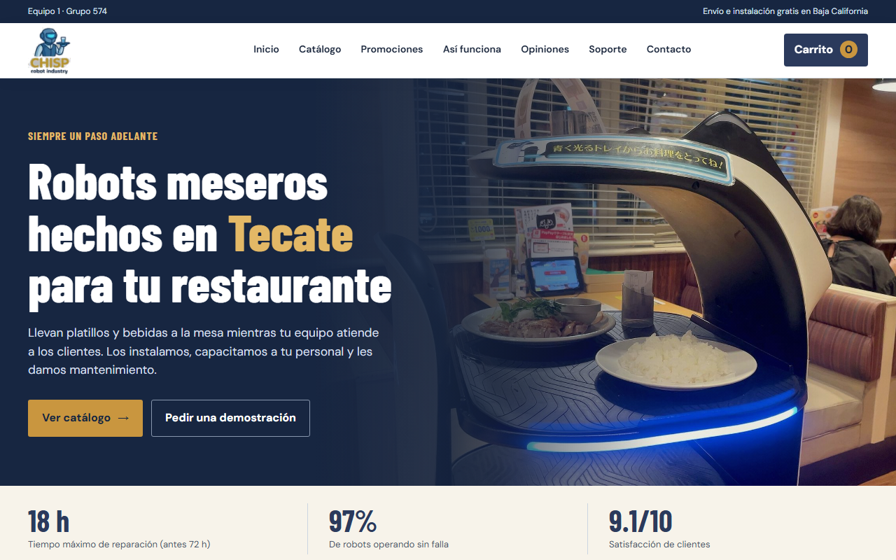

# Catálogo CHISP Robot Industry

Catálogo digital de robots meseros de CHISP, una empresa simulada de Tecate, Baja California. Proyecto universitario (Meta 5.1).

**Sitio:** https://elbaku16.github.io/chisp-catalogo/

## Qué incluye

- Catálogo con búsqueda, filtros y fichas técnicas
- Carrito de demostración con IVA y código de promoción (`CHISP3`)
- Promociones, garantías, preguntas frecuentes y políticas

Es un sitio estático: `index.html` y la carpeta `assets`. No envía ni guarda datos, y las compras son solo de demostración.

Las fotos de robots son de Wikimedia Commons, con licencias CC BY-SA 4.0 y CC0. Los créditos están al pie de la página.

## Equipo 1 · Grupo 574

- Cortez Hernández Lenin Baku
- Ramírez Astorga Jofiel Oryares
- Martínez Bazán Jesús Arturo
- Brito Ortiz Oscar Artemio
